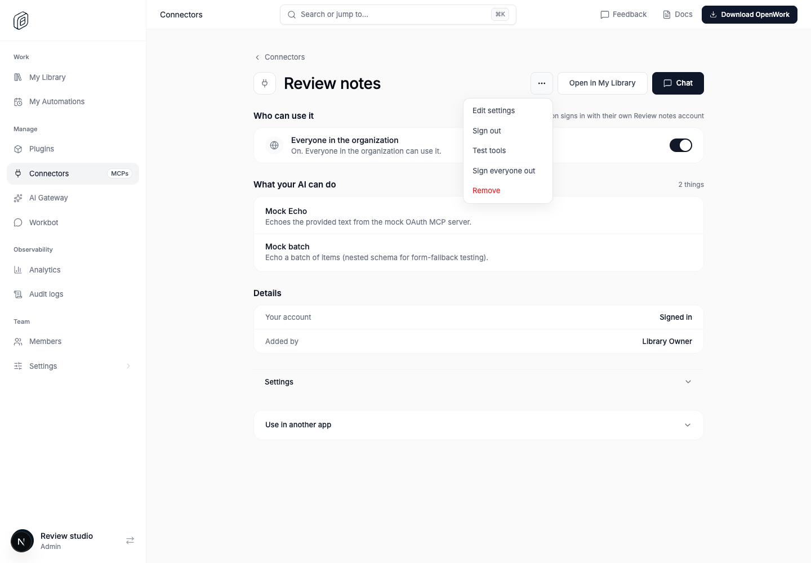
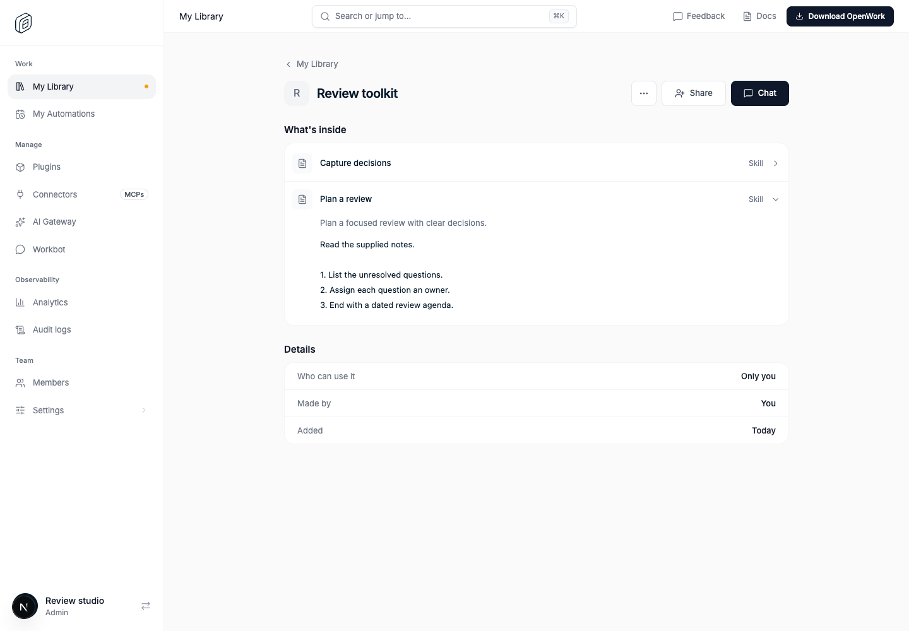

# Library connector navigation and skill previews

- Feature: `libraryConnectorNavigation`
- Deployments: Cloud and self-hosted
- Author: `benjaminshafii`
- Default: off

## What changes

Manage Connectors links to the same connector in My Library only when the
viewer has Library access. Personal sign-out uses the existing caller-scoped
disconnect action, separate from the organization-wide sign-out action.
Manage access alone does not grant Library access or personal credentials.

Skills expand inline to show their description and published steps in plugin
pages, plugin contents, and My Library. Library list previews load the existing
authorized plugin query only when expanded; they do not add a request per
plugin at page load. Skill source is displayed as text, not executable HTML.

## Try it

Enable `libraryConnectorNavigation` for a test organization in `/admin`.
Open an assigned connector in Manage and choose **Open in My Library**.
For a per-person connector, sign in, then use **Sign out** in its menu
(**Remove key** for a personal API key). Shared organization accounts never
offer personal sign-out. Verify an unassigned connector does not offer a
personal Library link.

Open a plugin containing skills in Manage or My Library, then expand a skill.
On the My Library list, expand **Skills**, then the skill name to read its steps.
Check keyboard disclosure, narrow windows, and a failed preview request with
**Try again**.

## Turning it off

Disabling the feature restores the previous navigation and static skill rows.
No grants, published versions, connector setup, or signed-in accounts change.
Existing member connector pages and personal sign-out remain available.

## Evidence

Assigned connector, with personal sign-out separate from organization sign-out:

Published skill steps expanded in the Library plugin detail:

`evals/proofs/library-connector-navigation.proof.test.ts` exercises the real Den
pages with assigned and unassigned connectors and published skill steps.
