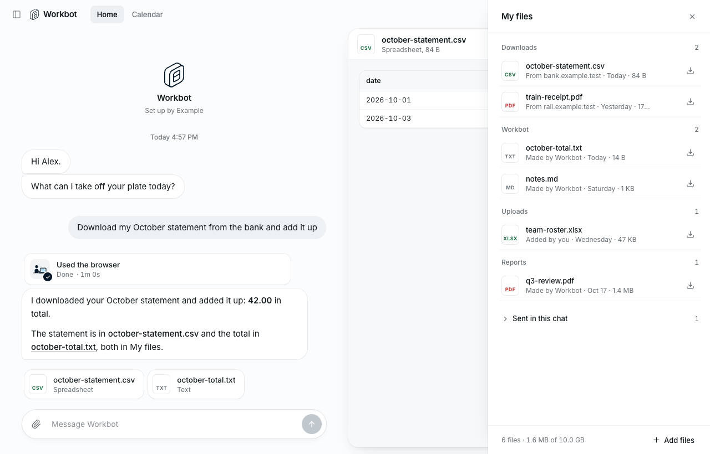
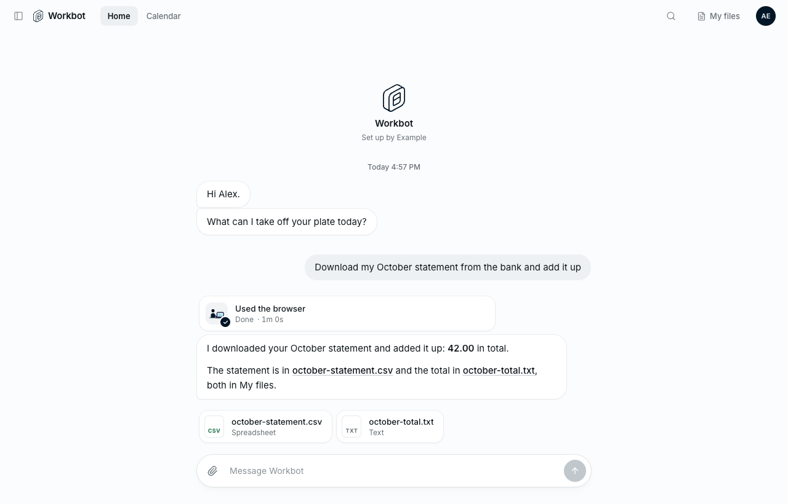
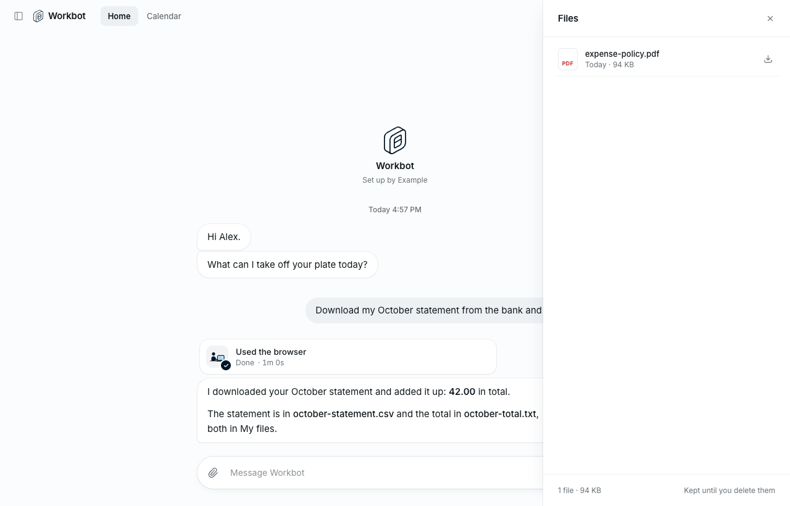

# My files: one file space per member, shared by their chats and Workbot's browser

- Feature key: `memberFiles`
- Deployments: cloud and self-hosted, off by default
- Author: @benjaminshafii

Each member gets one **My files** space at `/files`, shared by:

- headless runner turns (the file tools), in every chat of theirs that asks for it,
- Workbot's browser: downloads are saved to `/files/Downloads`, and the agent can
  upload any file in `/files` to a website.

A file the browser downloads in one chat can be read by the next turn in another
chat. A file the agent writes is something the browser can upload. Members see
and manage their files in Workbot's Files panel.

Computer use (commands and native apps on the conversation's computer) is out of
the product for now, so this does not sync `/files` with the computer. That work
(a two-way mirror around every command, with conflict copies) is kept on the
branch `feat/member-files-computer` for when computer use returns.



An answer links the files it made, and shows them as cards that open beside the
chat:



With the feature off nothing changes: the header says Files and lists the chat's
own files, and `/files` links in older answers are plain words.



## Layout

```
/files/                     the member's My files (per Den organization + member)
/files/Downloads/           browser downloads
/files/Uploads/             files the member adds from the Files panel
/files/agents/<agent>/      a persistent agent's own notes and output (Workbot: agents/workbot/)
<relative paths>            the conversation's scratch workspace, as before (throwaway)
memory/                     the owner's memory, as before
```

The scratch workspace and `memory/` are unchanged. In a conversation with My
files on, a tool path that starts with `files/` or `/files/` is My files.

## Where it is stored

The runner's existing file store (`HEADLESS_FILES=s3` or `disk`), under a
per-member prefix: `members/<sha256(owner)[:40]>/<random>`, one object per
version. A file's path, size, type, version and origin are rows in the runner's
SQLite (`member_files`, migration 4) with no `session_id` column, so:

- deleting a conversation never deletes the member's files (the rows and the
  objects are outside `sessions/<id>/`);
- moving a chat into its own cell never copies them;
- a conversation's export does not carry them.

On celld the rows live in the owner's cell (as owner memory does). A chat in its
own session cell reaches them with `/internal/member-files` (list, get, commit,
remove), answered only for chats in that owner's directory; the bytes go to and
from the shared bucket directly, under keys the owner cell recorded.

## Scoping model

**Space.** A space is named server-side, never by the browser or the model:
`member:<owner>`, where Workbot's owner is
`wb:<sha256("workbot:<orgId>:<memberId>")[:40]>`. The runner only ever sees that
hash. Tools take the owner stored on the session; the runner's owner routes take
it from the trusted service header (`x-openwork-headless-owner`), which Workbot
sets from Den's answer about who is signed in.

**Opt-in per session**, like `files`:

| Session setting | Meaning |
| --- | --- |
| `memberFiles: true` | The conversation gets `/files`. Needs `owner`. Slack, Automations and anything else that does not ask keep their exact behavior. |
| `agent: "<slug>"` | The agent this conversation acts as; its folder is `/files/agents/<slug>/`. Workbot sends `workbot`. |
| `background: true` | Nobody is waiting on this conversation (an Automation, a proactive agent): every turn writes only in its agent folder. |

**Who may write where:**

| Run | Reads | Writes |
| --- | --- | --- |
| A person's message | all of `/files` | all of `/files` |
| A background task (`start_task`), a read-only turn (`credentials.readOnly`), any turn of a `background` session | all of `/files` | only `/files/agents/<agent>/`; nothing without `agent` |
| A task's report | all of `/files` | nothing |

The same rule applies to the browser: a background run's downloads are saved to
`/files/agents/<agent>/Downloads/`, and a run that can't save keeps them out of
My files and says so.

**Paths can't escape.** Paths are normalized; `..`, empty segments, control
characters, more than 512 characters (255 per name) are refused. Every lookup is
by space and path (or space and id).

**Later: team and organization folders.** Rows are keyed by `space`, not owner.
A shared space (`team:<id>`, `org:<id>`) would be mounted read-write at
`/files/Shared/<name>/`, with the member's access passed per turn by Den the
way MCP scopes are today, and its rows kept in that space's cell. Member rows
don't change.

## How each surface reaches the files

**Runner file tools.** `list_files { path? }` (a folder of `/files`, or the
scratch workspace and the top of `/files`), `read_file` (text, or images, PDFs
and Office files the way `open_file` shows them), `write_file`, `edit_file`,
`delete_file`, and `save_file` (a `/files` path or a scratch file, handed to the
person in this chat). The system prompt tells the model where things go and to
link files it creates or changes as `[name](/files/path)`.

**The browser.** Workbot's browser runs on the conversation's computer. The
desktop bridge's new `files on|off` operation (root, image-owned, no arguments
from the model) creates `/files` there for the shared workspace group and points
the browser's `Downloads` at `/files/Downloads`; `files off` points it back at
`/workspace/out`. The runner moves bytes over the provider's file API; nothing on
the computer can reach the store.

- **Downloads.** After each browser call the runner saves new, finished
  downloads to My files, once each, attributed to the browser with the page's
  address when Chromium recorded it (`user.xdg.origin.url`). A download never
  replaces a file already in My files: it gets the next free name
  (`statement (2).pdf`). Files still downloading (`.crdownload`) wait for the
  next browser call. Saved downloads are listed in the tool result.
- **Uploads.** The browser's `act` takes `{type:"upload",ref,paths:["/files/…"]}`.
  The runner copies each file from My files onto the computer
  (`/files/.uploads/<hash>/<name>`, same name), then the browser clicks the
  observed control and answers the file chooser it opens with those files
  (Chromium's file-chooser interception, on only around that click). Only
  regular files under `/files` are accepted, never a link out of it. A file that
  isn't in My files, or a conversation without them, is refused before the
  browser does anything. The desktop app's browser has no uploads.

**Workbot.** The Files panel shows My files by folder, with where each file
came from ("From bank.example.test" for a browser download, "Made by Workbot",
"Added by you"), and preview, download, delete (asked
first) and Add files (into Uploads). The chat's own attachments stay
under "Sent in this chat". Files a turn wrote appear as cards under its answer,
and `/files/...` links in answers open the file. My files ids (`mf_…`) work
everywhere a chat file id (`fl_…`) does, so the preview panel is reused.

## Limits and errors

| Limit | Default | Setting |
| --- | --- | --- |
| One file | 100 MB | `HEADLESS_FILES_MAX_BYTES` (same as kept files) |
| One member | 10 GB | `HEADLESS_MEMBER_FILES_MAX_BYTES` |
| Files per member | 10,000 | |

Errors are sentences the model can pass on: "My files is full (9.8 GB of 10 GB).
Delete some files to make room.", "That file is 140 MB; the most a file in My
files can be is 100 MB.", "This run can only save in /files/agents/workbot/.".
A download over the per-file limit stays on the computer and is reported once.

## Desktop app (later)

v1 is cloud only. The desktop app could later mount the same space as a local
folder (`~/OpenWork/My files`) through a member-scoped Den proxy of the runner's
owner routes, or expose it to local agents as an MCP resource. Its own browser downloads would then be offered to
My files the way the cloud browser's are.

## Agent notes in `/files/agents/<agent>/` (later)

Persistent agents keep notes in the runner's `memory/` for now. To move them:
give the agent's session `memberFiles: true`, `agent: "<slug>"` and, when
unattended, `background: true`; copy the owner's `memory/` rows once into
`/files/agents/<slug>/notes/` (origin `agent`, newest wins, idempotent like
`adoptOwnerMemory`); then point the memory resolver at that folder, so the
memory section shown every turn comes from it and `memory/...` paths become an
alias for `/files/agents/<slug>/notes/...` during a deprecation window. The
agent can then write notes even from read-only or background runs, and the
member sees and edits them in My files.

## Turning it off

Safe at any moment. With the flag off, Den reports `memberFiles: false`,
Workbot hides My files, refuses `mf_…` ids and sends `memberFiles: false` on
the next session update. The runner stops routing `/files`, uploads are refused,
and the next browser call points Downloads back at `/workspace/out`. Stored files are kept, and come
back when the flag is turned on again.

## Deploy order

1. The runner (accepts the new session fields and owner routes).
2. A new desktop snapshot: the desktop bridge and the browser's task code
   changed, so the desktop identity changed (`snapshot:build:freestyle-desktop`
   / the Daytona desktop image).
3. Den and Workbot.
4. Turn the flag on for one organization in `/admin`.

## Deferred

Syncing `/files` with the computer (parked on `feat/member-files-computer`);
team and organization folders; a Den web page; desktop sync; rename and move; page previews for
Office files in My files; versions and trash; an orphan sweep for objects whose
commit never landed; deleting a member's space when they leave the organization;
saving a chat attachment into My files.

## How to try it

```sh
pnpm --filter @openwork-ee/headless-runner test:member-files        # store, tools, scopes, routes, cells
pnpm --filter @openwork-ee/headless-computer test                   # downloads and uploads on the computer
node --test packages/computer-use/chromium.test.mjs                 # the browser's upload answers only its own file chooser
pnpm --filter @openwork-ee/headless-runner member-files:e2e         # download in one chat → read and upload from another
pnpm evals:e2e workbot-member-files --local                         # Workbot's Files panel, headless
python3 ee/packages/headless-computer/scripts/desktop-bridge.test.py   # the desktop bridge's files on|off
```

The end-to-end check runs the runner's real HTTP API, file tools and My files
store, the computer's browser handling (desktop setup, downloads, upload copies,
the desktop bridge protocol), the cloud browser's own task code and a real
headless Chrome: a click downloads a statement in one chat, another chat reads it
with `read_file` and uploads it to a form, and the site receives it. The model
is scripted, and each conversation's computer is a folder on the machine running
it (`/files` and `/workspace` mapped into it), so it needs no cloud account. A
live check on a Freestyle or Daytona desktop needs the new desktop snapshot.
