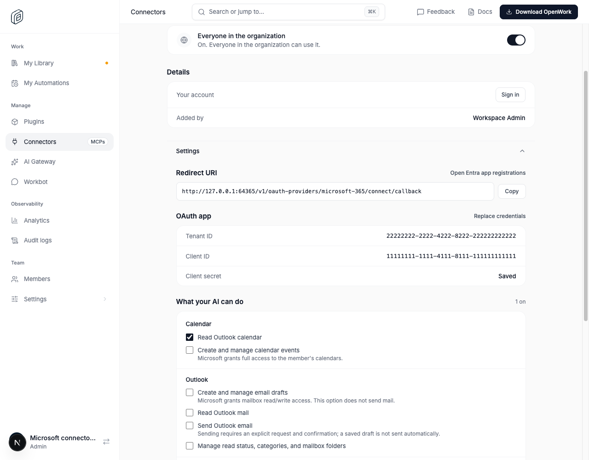
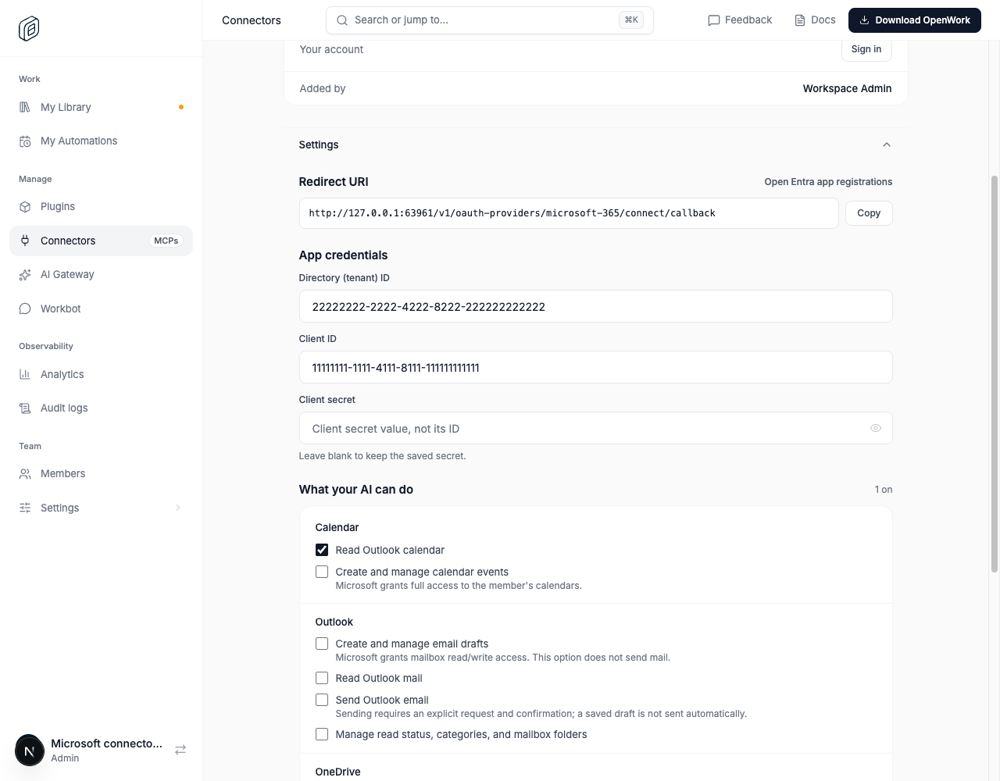
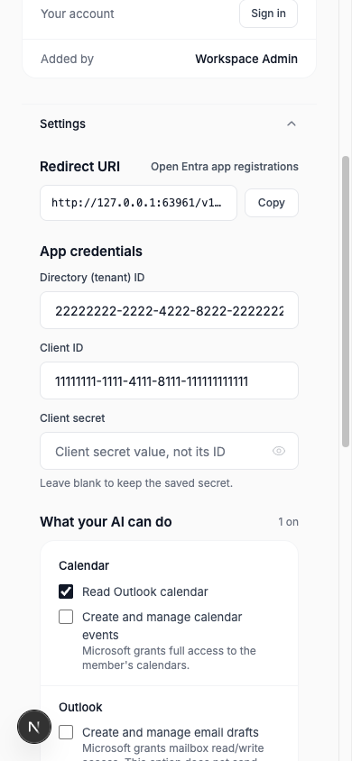
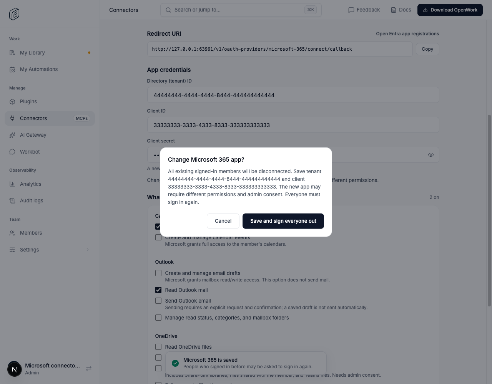
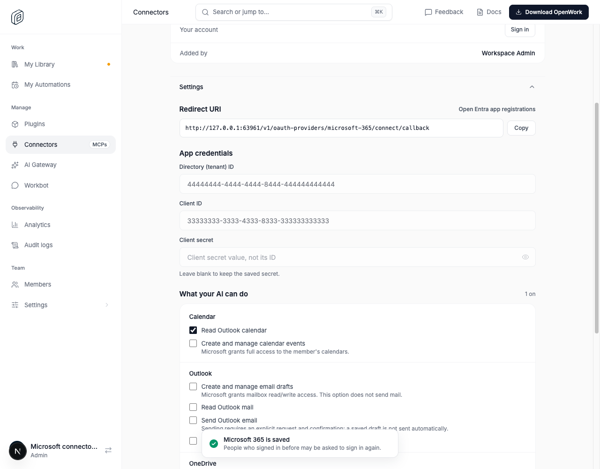

# Microsoft 365 credential editing

- **Feature:** `microsoftConnectorCredentialEditing`
- **Deployments:** cloud and self-hosted; off by default.
- **Owner:** [benjaminshafii](https://github.com/benjaminshafii)

## What changes

For an existing Microsoft 365 connector, Settings opens directly on editable
Directory (tenant) ID and Client ID fields. The stored secret is never returned
to the browser. A blank secret field keeps it unchanged; entering a value
replaces it. Saving permissions alone does not require another secret.

Changing the client ID requires a new secret for that app. Changing the client
or tenant ID warns that existing member accounts will be disconnected and asks
for confirmation before saving. Rotating only the secret does not sign members
out. The existing authorization and recent-sign-in checks still apply. No API
permission, credential-storage, token-revocation, or session policy changes are
introduced; this is a different UI for the existing save operation.

If a background refresh reports different app IDs while the form is open,
the form clears the entered secret and blocks saving until the user reloads.
This is a guard against observed stale UI state, not a new server-side
concurrency/transaction protocol.

Google Workspace and first-time connector setup retain their current flow.

## Try it

Enable the feature for a test organization from `/admin`, then open
Manage > Connectors > Microsoft 365 > Settings. Test editing each identifier,
keeping the saved secret, rotating only the secret, permission-only saving,
cancelling an identity-change confirmation, and a failed save. Use disposable
credentials, never production secrets in screenshots or evidence.

## Turn it off

Turning it off restores the existing Replace credentials flow. Unsaved form
drafts reset when the organization, connector, or rollout state changes, so a
draft cannot carry over to another connector or overwrite a newer saved value.
It does not modify saved app credentials or member connections; already-submitted
saves complete through the existing API. Do not turn the feature on for customer
organizations without an explicit rollout decision.

## Watch

Check save failures, unexpected sign-outs, and whether a blank secret remains
omitted from permission-only updates. The browser proof covers the actual Den
UI and API with disposable organization state.

## Screenshots

Real Den web screenshots from the browser proof, using disposable app IDs and
no production credentials:

### Rollout off: existing replacement action

### Rollout on: direct editing

### Identity-change confirmation

### Changed in another session

