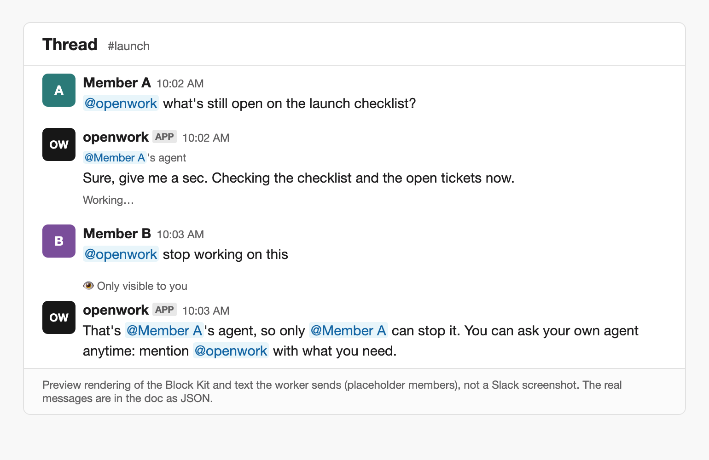

# Workbot in Slack: whose agent

Feature key: `slackAgentIdentity` · deployments: cloud and self-hosted · default: off · author: benjaminshafii

Everyone who mentions OpenWork in a Slack thread already gets their own agent, run as them in their own runner
session with their own credentials. In a shared channel those agents all post as the same `openwork` app, so they
looked like one bot: when one person asked "@openwork stop working on this", their own (idle) agent answered "I'm not
working on anything" while the other person's agent kept going. This feature makes it clear whose agent is acting and
lets only its owner steer it. Session and credential isolation is unchanged.



The image is a preview rendering of the payloads below with placeholder members, not a Slack screenshot.

## What changes when it's on

- **Owner line.** Each message of a reply in a shared channel or thread opens with a small context line mentioning
  the owner, `<@U…>'s agent`, which Slack shows as "@member's agent": Slack renders the mention as each viewer already
  sees that person, so OpenWork never reads, stores or posts a name. Like any mention from an app, it notifies the
  owner when the reply starts; a long task's answer that already mentioned them skips the extra "Done" ping. Private
  replies and DMs have no line, and hourly check-ins are unchanged.
- **Only the owner steers.** A message that only steers running work ("stop", "stop working on this", "never mind",
  "change that", "try again"; not "stop the deploy" or "change that to Friday"):
  - from the agent's owner, while their task runs in the thread: stops it, like Slack's Stop button. Before, it waited
    behind the task and then ran as a new request.
  - from anyone else, while someone's agent is replying in the thread and the sender has nothing running there: gets a
    private (ephemeral) note, and no task runs or counts toward their daily limit: "That's @member's agent, so only
    @member can stop it. You can ask your own agent anytime: mention @openwork with what you need."
  - otherwise: an ordinary request for the sender's own agent, as before.
- **Slack's Stop button** pressed by someone with nothing of their own running in the thread (the app shares one Slack
  session per thread, so everyone sees one Stop button) now gets the same private note instead of silently doing
  nothing. It still never stops another person's agent.
- An agent that replies privately (`--private`, private rollout) is never named to anyone else.

## The Slack payloads

The owner line is the first chunk of every `chat.startStream` call for a shared reply, so it shows above the first
words while the reply streams and on every continued message. The owner is the reply's `recipient_user_id`.

```json
{ "type": "blocks", "blocks": [{ "type": "context", "elements": [{ "type": "mrkdwn", "text": "<@U012345>'s agent" }] }] }
```

The note is `chat.postEphemeral` to the sender in the thread, naming the owner with the same mention. Ephemeral
messages are only delivered to the sender, so the owner isn't notified. Mentions are only ever built from Slack user
ids.

Why not `username` overrides: `chat.startStream`, `chat.postMessage` and `agents.sessions.setStatus` accept
`username`/`icon_url`, but only with the `chat:write.customize` scope, which the app's manifest doesn't request (adding
it means every workspace reinstalls). The context line works with today's scopes.

## How to try it

1. Turn `slackAgentIdentity` on for one organization in `/admin` › Features.
2. In a channel where the assistant is enabled (private rollout off), have two connected members each mention
   @openwork in the same thread with a request that takes a while.
3. Check each reply opens with its owner's mention. While one is still working, have the other member send
   "@openwork stop": they get the private note and the first reply continues. Then have the owner send
   "@openwork stop": their reply ends with "Stopped."

## Turning it off

New replies have no owner line and steering messages run as ordinary requests again. A reply already streaming keeps
its owner line: whether a reply shows it is decided once, when the task starts (`ownerLine` in the event checkpoint,
which expires with the event after seven days). Nothing else is stored.

## What to watch

- Logs: `slack_assistant_steered` (`action`: `stop_own` or `not_yours`) for each steering message handled, and
  `slack_assistant_steering_note_failed` when Slack refused the private note.
- If Slack ever refuses the blocks chunk (`invalid_chunks`, `invalid_blocks`), the message is sent again without the
  owner line, so an answer is never lost.

Code: `ee/apps/den-api/src/slack-assistant/steering.ts`, wired in `worker.ts` and `run.ts`. Tests:
`ee/apps/den-api/test/slack-assistant-steering.test.ts` and `test/api/slack-agent-identity.api.test.ts`.
