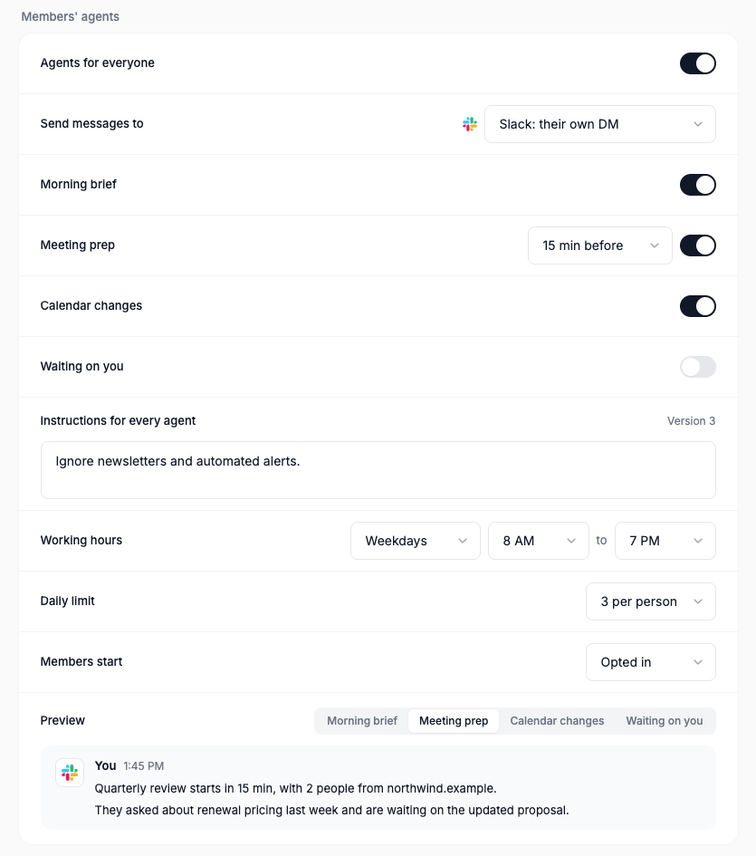

# Workbot: Your agent

Feature `workbotProactive` (cloud and self-hosted, off by default). Author: `benjaminshafii`.
It also needs Workbot on the deployment (`DEN_WORKBOT_URL`) and the headless runner (`DEN_HEADLESS_RUNNER_URL`).

Every member gets one persistent background agent, "Your agent", running in the cloud on the standard headless runner.
With no events at all it is still useful: a morning pass, then a check about every three hours inside working hours,
reading Gmail and Google Calendar since its last look. Calendar events only wake it sooner. It sends one short message
when something needs the member, and stays quiet otherwise. It only reads: it never sends, accepts or edits anything
for them.

## Architecture

```
wake: schedule (morning + ~3h)  ─┐
      calendar event (5-min diff)┴▶ one turn in the agent's own session ─▶ NO_REPLY | {message, items}
                                                                              │
                                     delivery step in Den (plain code) ◀──────┘
                                     quiet hours · snooze · mutes · one message per item · daily limit
                                                                              │
                                     the member's destination (a Connect connection + target) ◀┘
```

1. **Wake** (`den-api/src/workbot-proactive/worker.ts`). A Den loop claims agents whose `next_wake_at` is due, with a
   row lease, so replicas never run one agent twice. `next_wake_at` is the earlier of the next scheduled pass and the
   next calendar look. Only the schedule and calendar events wake an agent; the model never schedules its own.
2. **Gates** (`wake.ts`). Feature (with member overrides), Workbot deployed, the organization switch, the member's own
   on/off and snooze, a destination, at least one active responsibility, working days and hours in the member's
   calendar time zone.
3. **Event source** (pure, `@openwork/automations/proactive`). One read-only `events.list` as the member every five
   minutes, diffed against a checkpoint: a meeting with people from outside the company inside the lead time, or a
   meeting today or tomorrow someone else added, moved or cancelled. Each event wakes the agent once.
4. **The turn** (`turn.ts`). The agent's own durable session (`hs_agent_<hash>`), never the member's Workbot chat
   and never `memoryOf` it. Standard runner tools only, plus Connect tools with a read-scoped MCP token (`mcp:read`):
   Gmail search with `after:`, Calendar events. Not `credentials.readOnly`, which would remove the file tools, so the
   agent keeps its notes in `memory/`. Den starts each turn with a short prompt: why it woke, the last-look time per
   source, and the active responsibilities. The default answer is `NO_REPLY`; anything unparsable is silence.
5. **Delivery step** (`wake.ts`, pure rules in `decideAgentDelivery`). Quiet hours, snooze, responsibilities that are
   off or muted, the ledger (one message per item: responsibility plus the item's ref), and the daily limit. Past the
   limit, items are recorded as `capped` and never retried later.
6. **Deliver** (`deliver.ts`). Den, not the model, calls the destination connection's own send tool as the member,
   after policy: Slack's MCP server `slack_send_message` to the member's own DM (their Slack user id, learned once
   with `auth.test`) or to a channel they chose. Text is cleaned first: no `@channel`/`@here`/user mentions, and links
   only to the member's own Google workspace.

## Responsibilities (day one)

| Responsibility | What the member gets | Woken early by |
| --- | --- | --- |
| Morning brief | Today's meetings with other people, overlaps, what needs prep. Morning pass only | The schedule |
| Meeting prep | Before a meeting with people from outside the company: the last thread with them and what they're waiting on | A meeting with outsiders entering the lead time |
| Calendar changes | Meetings today or tomorrow that someone else added, moved or cancelled | The calendar diff |
| Waiting on you | External email unanswered for more than about 4 hours, with an offer to draft a reply in Workbot | The schedule |

Ignored: the member's own changes, declined meetings, all-day events, focus time, out of office, working location,
meetings with nobody else, anything after tomorrow.

## The template: a versioned `agent` config object

`agent` config objects are markdown agent definitions today (Library imports `AGENT.md` / `agents/*.md`: frontmatter
with `name` and `description`, then the agent's instructions), the OpenCode/Claude agent format. "Your agent" uses that
format and extends the frontmatter (`template.ts`):

```md
---
name: your-agent
description: Reads each member's Gmail and Google Calendar on a schedule and tells them only what needs them.
mode: primary
sources: gmail, google_calendar
responsibilities: morning_brief, meeting_prep, calendar_changes, waiting_on_you
schedule: morning pass, then every 3 hours in working hours
---
<the agent's instructions>

## Organization instructions
<the admin's short text>
```

The built-in default is version 1 and lives in code. An admin edit (responsibility toggles, organization instructions)
adds a `config_object_version` to the organization's one "Your agent" object (`openwork/agents/your-agent.md`). Each
member's agent is a small `agent_instance` row: the template version it last ran, the member's allowed overrides
(muted responsibilities, destination), status, snooze, `next_wake_at`, encrypted state and a lease.

## Admin settings (Manage › Workbot › Members' agents)

| Setting | Stored in | Default |
| --- | --- | --- |
| Agents for everyone | organization metadata `workbot.proactive.enabled` | off |
| Send messages to | `workbot.proactive.destination` (a Slack connection in Connectors; each person's own DM) | nowhere |
| Morning brief, Meeting prep (+ how early), Calendar changes, Waiting on you | the template (meeting lead time in metadata) | all on, 15 min |
| Instructions for every agent | the template | empty |
| Working hours | `workingDays`, `startHour`, `endHour` | weekdays, 8–19 |
| Daily limit | `dailyCap` | 3 per person |
| Members start | `membersStart` | opted in |

The page previews each kind of message as plain text. The switch stays visible but locked, with the reason, until a
destination is chosen or when the headless runner is missing (DESIGN.md P4, C5).

## Member controls

`GET /v1/me/agent` answers "what will my agent tell me about?": each responsibility with whether the organization
turned it on and whether the member muted it, where messages go, the hours and limit. `PUT /v1/me/agent` takes plain
choices: `on`, `snooze: "tomorrow" | null`, `mute` / `unmute`, `destination`. Both are tagged for Connect, so a member
can say "stop telling me about calendar changes" or "snooze until tomorrow" to Workbot. The agent's own `mcp:read`
token can read them but never change them. There are no buttons on messages and no Slack Home tab.

## Where notes live

The agent keeps its notes in its own session's scratch files under `memory/` (what it already told the member,
threads it is watching). Den stores only the calendar checkpoint, last looks and schedule. When the shared per-user
filesystem lands, the notes move to `/files/agents/<agent>/` and the session reads them from there.

## Slack: does a DM to yourself notify you?

Connect's Slack connection is Slack's own MCP server (`https://mcp.slack.com/mcp`, per-member OAuth). Slack's MCP OAuth
issues user tokens only, and `slack_send_message` needs the user scope `chat:write`, so it posts **as the member**
(Den's Slack binding checks `auth.test` and refuses bot tokens). A message the member posts into their own DM is their
own message: Slack notifies people about other people's messages (DMs, mentions, keywords, thread replies), never their
own, and the DM with yourself is Slack's notes space. So the default destination is a quiet log, not a ping. Not
live-tested.

Simplest alternative default: an email from OpenWork's own sender to the member's sign-in address. Den already sends
transactional email; it arrives unread from another sender, so normal mail notifications apply, and it needs no Slack
app or connection. It is not a Connect connection, so it would be the one exception to "destination = connection +
target". The other option, a Slack DM from a bot, needs a bot token, which Slack's MCP server does not offer.

## Safety

- **Read-only through MCP.** The turn's token is `mcp:read`: Den refuses every non-GET capability and every external MCP
  tool for it. Den delivers with write scope only after the delivery step, with text it cleaned.
- **No memory pollution.** The agent's reading stays in its own session. Only delivered text leaves it.
- **At most once.** A ledger row is reserved before sending, so a crash never sends twice. Silence wins on doubt: an
  unparsable answer, a runner outage or a failed model check mean no message.
- **Restraint in code.** Working hours, 3 a day by default, one message per item, mutes and snooze.

## Turning it off

The kill switch (or the organization switch) stops new wakes on the next tick; a pass already running re-checks the
feature right before delivering. Agent rows, sessions and ledger rows stay and are harmless. Turning it back on resumes
from the stored state.

## What this PR does not do yet

1. A model-in-the-loop eval: about 10 recorded calendar and inbox timelines replayed against the real runner and model,
   each 2–3 times, scored "should message" or "should stay quiet". Timelines to record: a quiet morning; a meeting
   moved by someone else; the member's own move; an external meeting in 15 minutes with an open thread; the same with
   nothing useful; an external email unanswered for 5 hours; the same answered; a newsletter; three changes in one
   hour past the daily limit; a cancelled meeting tomorrow.
2. Follow-ups ("remind me", "tell me when"): no `schedule_wake` tool yet.
3. Copying delivered text into the member's Workbot conversation.
4. A member settings page in Den web (the API and Connect capability exist).
5. Desktop notifications as a destination.

## Try it locally

```sh
pnpm dev:den:mysql && pnpm dev:workbot
# /admin › Features › Workbot: Your agent › on for your organization
# Connectors › add Slack (Slack's MCP server), then Den › Manage › Workbot › Members' agents
```

`pnpm --filter @openwork/automations test` and `pnpm --filter @openwork-ee/den-api test` cover the schedule, event
source, prompt, reply parsing, delivery rules, the turn's session and token, and delivery without a runner, Slack or
Google. `evals/proofs/workbot-proactive-settings.proof.test.ts` drives the admin page.

## Screenshots

Off, with nowhere to send messages yet (real Den, `workbotProactiveWorld`):


On, sending to each person's own Slack DM, with the template at version 3 and the meeting prep preview:


